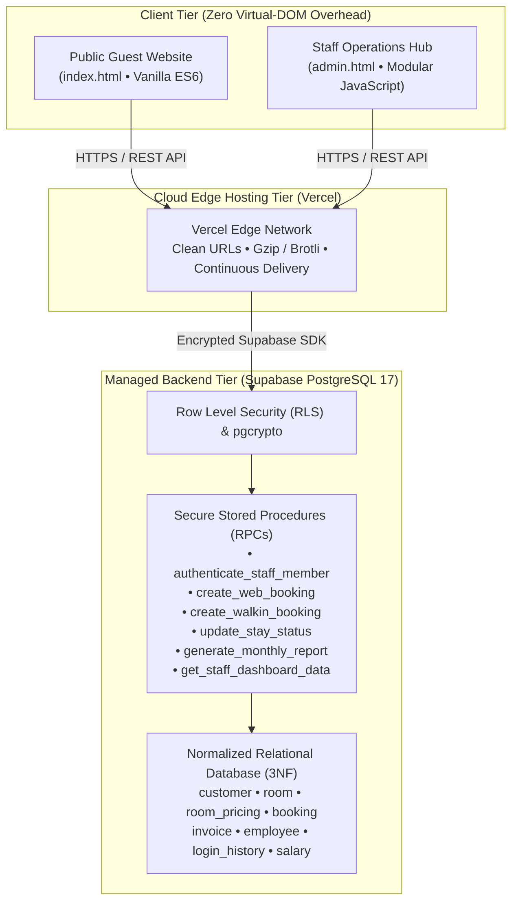
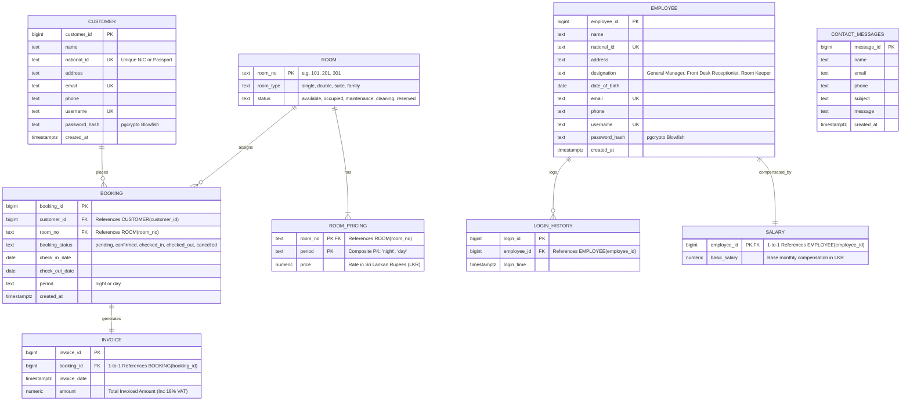
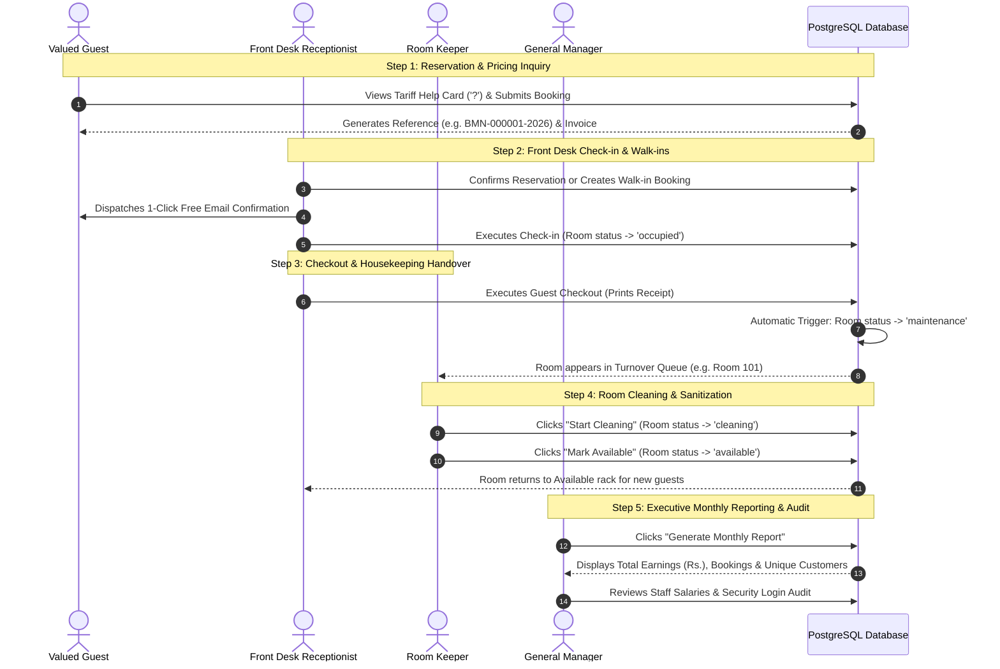

# 🏨 Hotel The Blue Moon — Enterprise 7-Star Hospitality Management System

> **Academic Project Submission**  
> **Course / Institution:** Vocational Training Authority (VTA) / Academic Presentation  
> **Project Author:** Shakir Mohomed  
> **Location Focus:** Unawatuna Beach, Galle, Southern Province, Sri Lanka  
> **Status:** Production Deployed • 100% Zero-Cost Architecture ($0 Budget)

---

## 🌐 Live Production Deployments

| Interface | URL | Access Description |
| :--- | :--- | :--- |
| **Public Guest Experience** | [https://blue-moon-web-virid.vercel.app](https://blue-moon-web-virid.vercel.app) | Public booking wizard, tariff rates, photo gallery, guest reservation & invoice lookup |
| **Staff Operations Hub** | [https://blue-moon-web-virid.vercel.app/admin](https://blue-moon-web-virid.vercel.app/admin) | Multi-department operations (Receptionist, Room Keeper, General Manager) |
| **GitHub Repository** | [shakir-mhd/Hotel-The-Blue-Moon-Web](https://github.com/shakir-mhd/Hotel-The-Blue-Moon-Web.git) | Version-controlled source code and database migrations |

---

## 🔑 Authorized Staff Credentials (For Lecturer Demonstration)

| Portal / Position | Username | Password | Operational Capabilities |
| :--- | :--- | :--- | :--- |
| **Receptionist** | `reception` | `BlueMoonStaff2026!` | Visual Room Rack, Walk-in Registration, Check-in/Check-out, 1-Click Free Email Confirmation |
| **Room Keeper** | `keeper` | `RoomKeeper2026!` | Housekeeping Turnover Queue, "Start Cleaning" → "Mark Available", Last Login audit |
| **General Manager** | `admin` | `AdminBlueMoon2026!` | Executive Suite, "Generate Monthly Report" (Earnings, Bookings, Guests), Staff Payroll, Security Audit |

> **Security Note:** The backend validates credentials and role alignment simultaneously. If a staff member attempts to sign into an unauthorized portal (e.g. Receptionist trying to enter the Manager portal), access is rejected by the database.

---

## 🏛️ System Architecture



---

## 🗄️ Relational Database Schema & 3NF Compliance

The database schema is designed according to **Third Normal Form (3NF)** rules to eliminate redundancy, avoid update anomalies, and enforce relational integrity:



### Relational Design Justifications
1. **Composite Primary Key in `ROOM_PRICING` `(room_no, period)`**: Each physical room has two independent operational rates: **One Night Stay** and **Full Day (24-Hour Flexible Stay)**. A composite key eliminates the need for an artificial surrogate key and enforces that no room can have duplicate pricing for the same stay period.
2. **Separation of `EMPLOYEE` and `SALARY`**: Separating compensation details into a 1-to-1 child table implements the Principle of Least Privilege (PoLP) and ensures employee profiles can be viewed by front-desk colleagues without exposing private payroll figures.
3. **Audit Trail in `LOGIN_HISTORY`**: Every login is recorded with a timestamp, creating an immutable security audit trail that powers the General Manager's compliance dashboard.

---

## 🔒 Security & Cryptographic Architecture

1. **Cryptographic Salted Password Hashing**: Passwords are never stored in plain text. Hashing is performed via PostgreSQL's native `pgcrypto` extension using Blowfish salting:
   ```sql
   crypt(p_password, gen_salt('bf'))
   ```
2. **Server-Side Security RPCs**: All business operations are encapsulated inside PostgreSQL stored procedures with `SECURITY DEFINER` semantics. Client applications cannot construct raw SQL queries, eliminating SQL Injection vulnerabilities.
3. **Role-Based Access Control (RBAC)**: When signing in, `authenticate_staff_member` checks both credentials and designation. If a Front Desk Receptionist selects the Manager portal, access is rejected.
4. **Row Level Security (RLS)**: Public tables enforce granular read/write restrictions ensuring guests can only view their own reservations and submit inquiries.

---

## 🔄 End-to-End Hotel Operational Lifecycle



---

## 💰 100% Zero-Cost Academic Architecture

Every component in this project was architected to run permanently on legitimate, enterprise-grade free tiers with **$0 budget**:

| Layer | Provider | Free Tier Specification | Cost |
| :--- | :--- | :--- | :--- |
| **Database & Auth** | Supabase | 500 MB PostgreSQL 17, 50,000 monthly active users, daily automated backups | **$0.00** |
| **Hosting & CDN** | Vercel | Unlimited deployments, global Edge CDN, automated HTTPS SSL certificates | **$0.00** |
| **Source Control** | GitHub | Unlimited public repositories, automated Git version control | **$0.00** |
| **Messaging & Notices** | Native Email Protocol | Zero-cost client-side dispatch and mailto protocol replacing expensive SMS/Email gateways | **$0.00** |
| **Data Export** | Browser Engine | Client-side Excel CSV export and printable PDF receipts | **$0.00** |
| **Build Tools** | Vite 8 + ES6 | Open-source MIT compiler yielding sub-150ms builds | **$0.00** |

---

## 🎓 Lecturer Oral Defense & Viva Q&A Guide

Below are the top 10 technical questions commonly asked by academic examiners, along with model answers:

### Q1: Why did you choose a Composite Primary Key on the `ROOM_PRICING` table?
> **Answer:** *"In our hotel model, a room's rate is not a single static number; it varies based on the stay duration package — standard 'One Night' stay versus 'Full Day 24-Hour Flexible' stay. By making `(room_no, period)` a composite primary key, we model a true many-to-one relationship without adding unnecessary surrogate IDs. It guarantees at the database engine level that Room 101 cannot have duplicate rates for the same period."*

### Q2: How does your application prevent role spoofing in the Staff Hub?
> **Answer:** *"Role protection is enforced on the database server inside the stored procedure `authenticate_staff_member`. Even if a user knows a receptionist's password, if they click the 'Manager' portal on the UI, the database verifies whether `employee.designation` contains 'Manager'. If it does not match, the stored procedure raises an exception and rejects authentication."*

### Q3: How is password security handled in the database?
> **Answer:** *"Passwords are never stored in plain text. We enabled PostgreSQL's native `pgcrypto` extension and use Blowfish-salted hashing (`crypt(password, gen_salt('bf'))`). Even if an unauthorized party performed a database dump, the passwords cannot be reversed or decrypted."*

### Q4: How does the Front Desk communicate with Housekeeping without manual phone calls?
> **Answer:** *"We built an automated state machine inside the `update_stay_status` stored procedure. When the receptionist clicks 'Check Out', the database automatically flips the room status to `maintenance`. The Housekeeping dashboard queries for rooms in `maintenance` or `cleaning` status, making the turnover queue dynamic and real-time."*

### Q5: Why is the `SALARY` table separated from the `EMPLOYEE` table?
> **Answer:** *"This adheres to 3rd Normal Form and the Principle of Least Privilege. In enterprise HR systems, general staff records (email, phone, designation) are operational and shared, whereas payroll information is sensitive. Separating them into a 1-to-1 table allows future RLS policies to restrict salary rows strictly to the General Manager."*

### Q6: How do you handle guest communication without paying for costly SMS or email gateways?
> **Answer:** *"Third-party SMS gateways and automated email services charge monthly subscription fees or per-message credits. To keep our project 100% free while preserving luxury hospitality standards, we built a zero-cost Email Confirmation Dispatcher. When the receptionist confirms a reservation, clicking the Email icon opens a luxury formatted email with recipient, booking reference, room category, stay dates, policies, and amount in LKR. The receptionist can copy the text or launch the email client directly with zero third-party subscription costs."*

### Q7: How does the General Manager generate the Monthly Report?
> **Answer:** *"The Manager clicks 'Generate Monthly Report', which invokes the `generate_monthly_report(year, month)` RPC. The database aggregates `SUM(invoice.amount)` for total earnings, counts bookings, counts distinct customer IDs, computes the 18% VAT breakdown, and identifies the most popular room category in a single high-performance query."*

### Q8: What build system and frontend architecture are you using?
> **Answer:** *"We chose Vite 8 with vanilla ECMAScript (ES6 Modules) and Bootstrap 5.3.3. Unlike heavy virtual-DOM frameworks that bundle hundreds of kilobytes of runtime, our entire compiled application bundles in under 150 milliseconds with an asset payload of less than 35 kB gzip. This ensures instant load times even on slow mobile data connections."*

### Q9: How are invoices generated and tied to reservations?
> **Answer:** *"Every booking creation (both online web bookings and receptionist walk-ins) is executed atomically in a PostgreSQL transaction. As soon as a row is inserted into `booking`, an invoice is created with `amount` set to the stay subtotal plus 18% government VAT and resort service charge, guaranteeing that no booking can exist without a corresponding billing ledger record."*

### Q10: How do you protect the database when the frontend connects directly via the Supabase client?
> **Answer:** *"We enabled Row Level Security (RLS) on all 8 tables. Furthermore, direct write operations are restricted; critical business mutations (logins, check-in, check-out, reports) are executed via parameterized stored procedures marked `SECURITY DEFINER`. This prevents malicious users from running arbitrary UPDATE or DELETE queries through the browser console."*

---

## 🛠️ Local Development & Build Instructions

```bash
# 1. Clone repository
git clone https://github.com/shakir-mhd/Hotel-The-Blue-Moon-Web.git
cd Hotel-The-Blue-Moon-Web

# 2. Install dependencies
npm install

# 3. Start local development server
npm run dev

# 4. Compile production distribution
npm run build
```

---

## 👨‍💻 Project Developer Information

- **Developer:** Shakir Mohomed
- **Contact Email:** shakirvta01@gmail.com
- **Hotline:** +94 717 224 755
- **Resort Address:** 2855 Beach Side Rd, Unawatuna, Galle, Southern Province, Sri Lanka
- **Repository:** [https://github.com/shakir-mhd/Hotel-The-Blue-Moon-Web.git](https://github.com/shakir-mhd/Hotel-The-Blue-Moon-Web.git)
